<div align="center">


<h3>The open-source AI video studio that runs on your own machine.</h3>

Generate shots, recast characters, paint effects onto real footage and cut the
final film in one local workspace, using open-weight models and native ComfyUI
workflows. It runs locally with no credits, uploads or closed APIs; Comfy Cloud
is optional, studio by studio.

[](LICENSE)
[](https://github.com/ItsSNOWMOBILE/aftertake/actions/workflows/ci.yml)
[](#how-its-built)
[](https://github.com/Comfy-Org/comfy-typescript-sdk)
[](docs/mcp.md)
[](#quick-start)

**[Watch the film](https://itssnowmobile.github.io/aftertake/film/)** ·
**[Try it in your browser](https://itssnowmobile.github.io/aftertake/studio/)** ·
**[Quick start](#quick-start)** ·
**[How it's built](#how-its-built)** ·
**[Docs](docs/studio-guide.md)**

</div>

<br>

## Then comes the Aftertake

[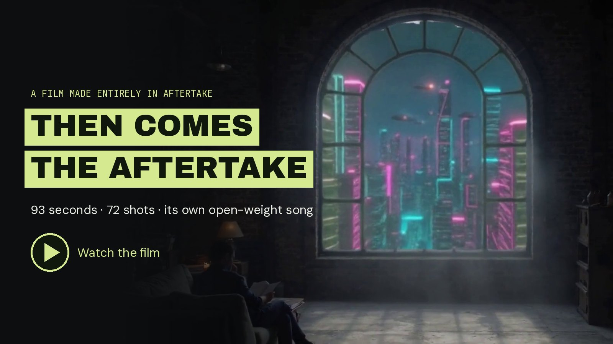](https://itssnowmobile.github.io/aftertake/film/)

<p align="center"><b><a href="https://itssnowmobile.github.io/aftertake/film/">▶ Watch the 93-second film</a></b> · <a href="https://github.com/ItsSNOWMOBILE/aftertake/releases/download/then-comes-the-aftertake-2026-10-22/then-comes-the-aftertake.mp4">Download the MP4</a> · <a href="examples/then-comes-the-aftertake/README.md">Open its editable projects</a></p>

A film about Aftertake, made in Aftertake. It cuts through generated portals,
castles, recast characters and finishing looks to its own song, which was made
with open-weight ACE-Step 1.5, with each section under its sung line. All 72
shots, 84 titles and 26 transitions are native, editable Film layers, cut to beats
measured by `aftertake_detect_beats`. The film also shows how a take is built:
the real ComfyUI graph, the `@comfyorg/sdk` calls, a recorded run on an RTX 5080
and a live agent session over MCP. Its generated plates were then upscaled ×2 on
Comfy Cloud with Aftertake's own Upscale studio, and the scenes re-rendered
unchanged.

## What you can make

<table>
  <tr>
    <td colspan="2" width="50%"><a href="docs/studio-guide.md#one-tap-effects">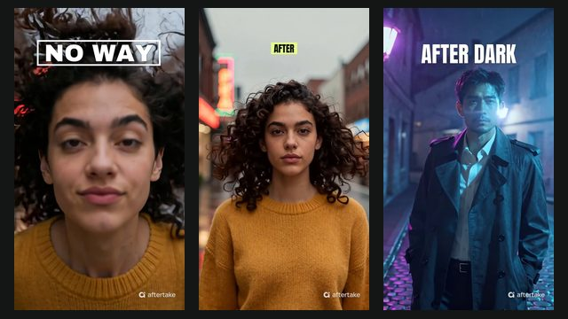</a></td>
    <td colspan="2" width="50%" valign="middle"><b>One-tap effects</b><br><sub>One photo in, a vertical clip to share out. Pick one of ten effects: Animate a frame moves the camera on LTX-2.5, an automatic check re-renders a blank, frozen or short take, and Film adds titles, a transition, an ACE-Step song and a small watermark you can turn off. Every effect is one JSON file.</sub></td>
  </tr>
  <tr>
    <td colspan="2" valign="middle"><b>Storyboard</b><br><sub>One idea becomes a film. A local language model plans 3 to 5 shots you can edit, each renders with LTX-2.5, ACE-Step scores them, and the cut lands on the song's beats with titles and transitions, ready to keep editing in Film.</sub></td>
    <td colspan="2"><a href="docs/studio-guide.md#storyboard">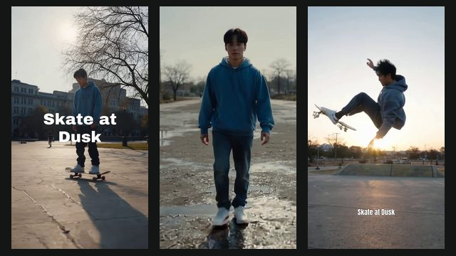</a></td>
  </tr>
  <tr>
    <td width="25%"><a href="docs/text-video.md"></a><br><b>Create video</b><br><sub>Text to video with sound, native LTX-2.5.</sub></td>
    <td width="25%"><a href="docs/studio-guide.md#create-image">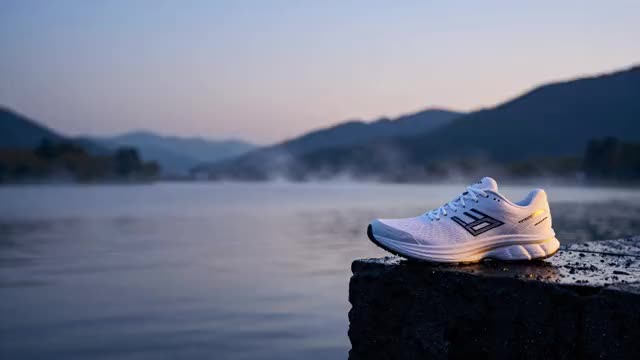</a><br><b>Create image</b><br><sub>Stills and first frames with Z-Image Turbo.</sub></td>
    <td width="25%"><a href="docs/studio-guide.md#animate-a-frame">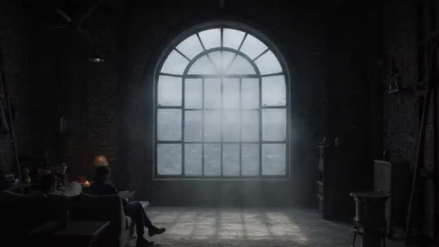</a><br><b>Transform a region</b><br><sub>Paint a timed cue; the effect composites onto your footage.</sub></td>
    <td width="25%"><a href="docs/studio-guide.md#replace-character">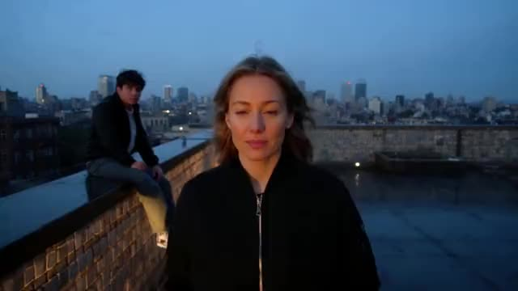</a><br><b>Replace a character</b><br><sub>Track a person with SAM3, recast them with MiniMax H3.</sub></td>
  </tr>
  <tr>
    <td><a href="docs/studio-guide.md#animate-a-frame"></a><br><b>Move the camera</b><br><sub>Animate a frame with 27 camera moves, from 360° orbit to FPV drone.</sub></td>
    <td><a href="docs/studio-guide.md#transfer-motion">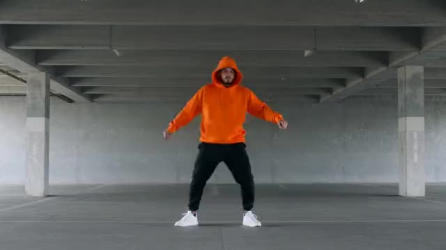</a><br><b>Transfer motion</b><br><sub>Your character, their performance, with Wan Animate 2.</sub></td>
    <td><a href="docs/finishing.md">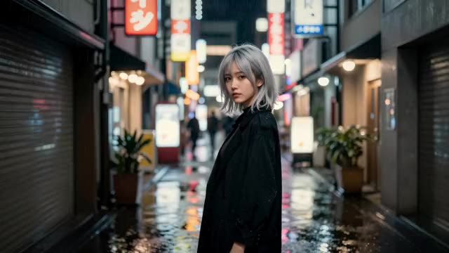</a><br><b>Color &amp; finish</b><br><sub>Looks, curves, LUTs, grain and Hide details.</sub></td>
    <td><a href="docs/motion-graphics.md">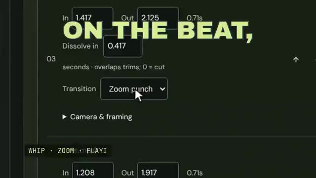</a><br><b>Cut the film</b><br><sub>Titles, transitions, narration and music on the beat.</sub></td>
  </tr>
</table>

Every card is a real result made in Aftertake. Start from 18 editable recipe
starters (product shots, TV spots, UGC, unboxings, try-ons and more, adapted from
[Higgsfield's public skills](https://github.com/higgsfield-ai/skills/tree/f83af0bc1d937c8119099a11f8ebbf5e6fb99819)),
or from a blank prompt.

## Highlights

<table>
  <tr>
    <td width="50%" valign="top">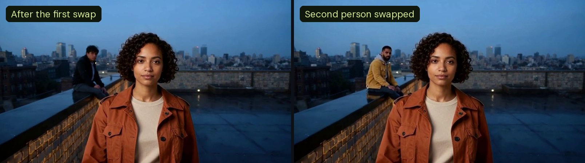</td>
    <td width="50%" valign="top">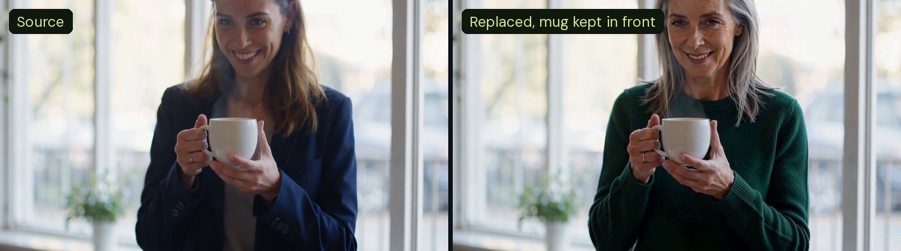</td>
  </tr>
  <tr>
    <td><b>Recast everyone in the shot.</b> Swap one person, then the next: each pass changes only the pixels inside its own tracked mask. <a href="examples/character-two-people/prompt-retry/README.md">Two-person example</a></td>
    <td><b>Keep what's in front.</b> Depth runs on your NPU or Neural Engine and puts back anything nearer the camera than the person, like this mug. <a href="examples/foreground-protection/prompt-retry/README.md">Café example</a></td>
  </tr>
  <tr>
    <td valign="top"><br><sub>Same frame, same crop: the source enlarged, and SeedVR2 ×2.</sub></td>
    <td valign="top">
      <b>Enhance any clip.</b> Upscale ×2 with SeedVR2, smooth motion to 48 fps or
      slow motion ×4 with RIFE, or compose a song with ACE-Step 1.5 from style tags
      and lyrics. All five operations were verified on an RTX 5080.
      <a href="examples/enhance/README.md">Results and timings</a>
      <br><br>
      <b>Repair the mask.</b> When tracking drops a person for a moment, Repair mask
      fills the gap on the CPU in seconds and shows exactly what it added.
      <br><br>
      <b>Know the time before you render.</b> Every render button shows how long the
      job usually takes on your GPU, from your own past runs.
    </td>
  </tr>
</table>

**Also in the studio:** [2–4 takes](docs/studio-guide.md#takes) of one image, video or shot, compared side by side with synced playback · a [moves gallery](docs/studio-guide.md#animate-a-frame) of 27 camera moves, each
with a real preview loop · [punch titles and transitions](docs/motion-graphics.md#punch-typography)
(slam, pop, glitch, whip, zoom, wipe) · beat detection that snaps cuts to music ·
tracked [subject copies](examples/subject-duplicates/README.md) · [layers and masks](docs/layer-stack.md)
with 27 blend modes · [depth and light](docs/depth-effects.md) for stills ·
local [narration](docs/narrated-cut.md) · selective HSL, curves and 3D LUTs ·
[Hide details](docs/finishing.md#hide-details), which blurs every place a username appears in a screen recording.

## Quick start

You need [Node.js 22+](https://nodejs.org) and Git. The launcher checks your
computer, installs what's missing and opens the studio in your browser.

```sh
git clone https://github.com/ItsSNOWMOBILE/aftertake.git
cd aftertake
node scripts/aftertake.mjs --examples
```

Or double-click `start.cmd` (Windows), `start.command` (macOS) or `start.sh`
(Linux). `--examples` opens a workspace full of recorded results; leave it off
to start with your own. `node scripts/aftertake.mjs doctor` prints the checklist.

**No GPU is needed** for the examples, editing, Film, Color & finish or agents.
To generate new footage, add a model profile on Windows or Linux with an NVIDIA
GPU (tested on an RTX 5080 with 16 GB):

```sh
node scripts/aftertake.mjs setup-gpu --video     # or --image, --character-swap, --upscale, --song, …
node scripts/aftertake.mjs setup-npu             # depth on the Neural Engine or an NPU, optional
```

**No NVIDIA GPU, or missing a model?** Comfy Cloud is optional, studio by
studio: add a key from a paid Comfy Cloud plan in Render setup, then choose
[Comfy Cloud](docs/cloud-setup.md) for any of images, text to video, upscaling,
smooth and slow motion, or songs. Everything else keeps your local models.

**Show it to someone?** `node scripts/aftertake.mjs share` runs a separate copy
behind an access link, with a daily render allowance for each visitor.
[Share a live link](docs/share.md) puts it online with a free Tailscale Funnel.

<details>
<summary><b>All model profiles</b></summary>

<br>

| Profile | Flag | Models |
| :--- | :--- | :--- |
| Text to video with sound | `--video` | LTX-2.5 |
| Images | `--image` | Z-Image Turbo |
| Reference-frame editing | `--frame-edit` | Qwen-Image-Edit |
| Painted region effects | `--region-edit` | LTX-2.5 with the in/outpainting adapter |
| Camera guidance | `--camera` | LTX motion-track IC-LoRA |
| Motion transfer | `--motion-transfer` | Wan Animate 2 |
| Character replacement | `--character-swap` | SAM3 + MiniMax H3 (needs FFmpeg) |
| Still-image depth | `--depth` | Depth Anything 3 Small |
| Upscale ×2 | `--upscale` | SeedVR2 3B |
| Smooth and slow motion | `--interpolate` | RIFE 4.26 |
| Songs | `--song` | ACE-Step 1.5 |

Add `--models-dir=PATH` to keep models on another disk. Every download is
pinned by revision, size and SHA-256. Render setup in the studio shows which
tools are ready and the command that fixes each one. See
[hardware and GPU selection](docs/hardware.md) and the [studio guide](docs/studio-guide.md).

</details>

## How it's built

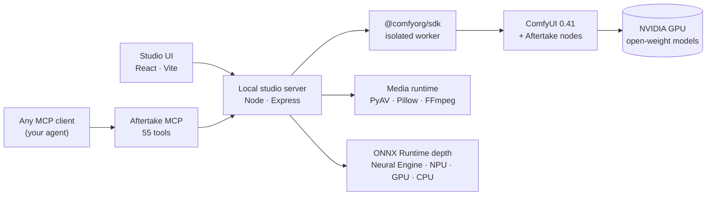

- **Native ComfyUI workflows.** Every generation is an API-format ComfyUI graph
  submitted through the official [Comfy SDK](https://github.com/Comfy-Org/comfy-typescript-sdk)
  to your local engine. Download the graph from any result to continue in ComfyUI.
- **Open weights only.** No partner nodes or closed APIs. Inference runs on
  ComfyUI's own model nodes; a small pack of [Aftertake nodes](custom_nodes/aftertake)
  loads, masks, composites and saves media around them.
- **Every result is a recipe.** Jobs keep their request, seed, content hashes and
  the graph that actually ran. Film projects keep every cut, title and sound.
  Crashes and reconnects rejoin the same job instead of starting a new one.
- **Agents are first-class.** The [MCP server](docs/mcp.md) exposes the same
  studio: generate, track and replace, enhance, plan an edit, voice a script,
  export, and review decoded frames. Your own agent supplies the language model.
- **The editing runs on the CPU.** Film export, finishing, layers, mask repair
  and narration need no GPU; depth for foreground protection uses the best
  accelerator you have.

<details>
<summary><b>Models and licenses</b></summary>

<br>

| Task | Model | License |
| :--- | :--- | :--- |
| Video, text to video, frame animation, region effects | LTX-2.5 and LTX-2 adapters | LTX model license |
| Images | Z-Image Turbo | Apache-2.0 |
| Reference-frame edits | Qwen-Image-Edit | Apache-2.0 |
| Person tracking · character replacement | SAM3 · MiniMax H3 + Character Swap LoRA | see model cards |
| Motion transfer | Wan Animate 2 | Apache-2.0 |
| Upscale ×2 | SeedVR2 3B | Apache-2.0 |
| Frame interpolation | RIFE 4.26 | MIT |
| Songs | ACE-Step 1.5 | Apache-2.0 |
| Still depth · foreground depth | Depth Anything 3 Small · V2 Small | Apache-2.0 |
| Narration | Kokoro | Apache-2.0 |

Model weights keep their own terms, separate from Aftertake's MIT code. Each
profile's exact files are pinned in `docs/models-*.json`; see
[credits and licenses](docs/studio-guide.md#credits-and-licenses).

</details>

## Made with Aftertake

<table>
  <tr>
    <td width="50%">
      <a href="https://github.com/ItsSNOWMOBILE/aftertake/releases/download/take-the-lead-review-2026-10-20/aftertake-take-the-lead.mp4">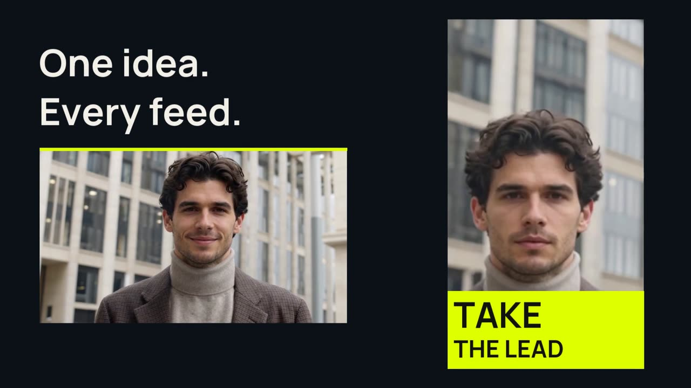</a>
      <b>Take the lead</b> · 94 s<br><sub>One shot becomes a campaign: an H3 replacement, a tracked subject in a design, animated headlines and a portrait cut. <a href="examples/take-the-lead/README.md">How it was made</a></sub>
    </td>
    <td width="50%">
      <a href="examples/hotel-lobby/walkthrough.mp4"></a>
      <b>Hotel Lobby, recast</b> · 26 s<br><sub>A supplied portrait becomes the performer on the left, from tracked selection to matched before and after. <a href="examples/hotel-lobby/README.md">Workflows and project</a></sub>
    </td>
  </tr>
  <tr>
    <td>
      <a href="https://itssnowmobile.github.io/aftertake/make-it-yours/"></a>
      <b>Make it yours</b> · 40 s<br><sub>A vertical ad whose hook changes in the real editor, then tracked copies and character replacement. <a href="examples/product-film/README.md">Editable projects</a></sub>
    </td>
    <td>
      <a href="examples/subject-duplicates/result.mp4"></a>
      <b>One performance, extra copies</b><br><sub>A dancer tracked once and repeated without regenerating face or motion. Replays on the CPU. <a href="examples/subject-duplicates/README.md">Example</a></sub>
    </td>
  </tr>
</table>

The [example library](examples/README.md) holds dozens of recorded projects with their
inputs, outputs, recipes, executed graphs and attribution. Explore them without
installing anything in the **[browser editor](https://itssnowmobile.github.io/aftertake/studio/)**.

## Documentation

| Guide | What's inside |
| :--- | :--- |
| [Studio guide](docs/studio-guide.md) | Every studio, its controls, setup profiles and troubleshooting |
| [Text to video](docs/text-video.md) | Native video and audio sampling, formats and render evidence |
| [Motion graphics](docs/motion-graphics.md) · [scenes](docs/motion-scenes.md) | Titles, shapes, transitions, groups and depth |
| [Color & finish](docs/finishing.md) | Looks, curves, LUTs, optical effects and Hide details |
| [Narrated cuts](docs/narrated-cut.md) | Scripts, measured voices, captions and pacing |
| [MCP reference](docs/mcp.md) | Agent setup, all 55 tools and recovery behavior |
| [Hardware](docs/hardware.md) | GPU selection, memory policy and precision |
| [Share a live link](docs/share.md) | Let someone use your studio through an access link and a tunnel |
| [Architecture](docs/competition.md) | How the build works and what is reproducible |
| [Media attribution](docs/media-attribution.md) | Footage, fonts, music and generated references |

## Development

```sh
pnpm install
pnpm dev        # studio server with reload
pnpm test       # 400+ TypeScript tests
pnpm lint
pnpm build
```

Python media tests run with `python -m unittest discover -s tests -p "test_*.py"`
in the media runtime (`.runtime/film-venv`) or the engine runtime (`.runtime/venv`).
Contributions are welcome; see [CONTRIBUTING.md](CONTRIBUTING.md).

## Status

Aftertake is an independent, experimental project built for Comfy's
[Open Source Higgsfield challenge](https://comfy.org/open-source-higgsfield/).
Generative results still need human review: likeness, hands, occlusions and
camera adherence vary by shot, and a passing technical check is not a judgment
of visual quality. Optional Comfy Cloud rendering was tested end to end on a
Standard plan on October 22, 2026: one image, song, smooth-motion clip, upscale
and text-to-video clip, each finished by the studio's usual checks
([record](docs/cloud/oct22-cloud-validation.json)). Aftertake does not claim
full Higgsfield feature parity.

## License and acknowledgments

Aftertake's application code and custom nodes are **[MIT licensed](LICENSE)**.
Model weights, third-party runtimes, fonts and footage keep their own terms.

Built with [ComfyUI](https://github.com/Comfy-Org/ComfyUI), the
[Comfy SDK](https://github.com/Comfy-Org/comfy-typescript-sdk),
[H3 Relay](https://github.com/akatz-ai/h3-relay), LTX, MiniMax H3, SAM3,
Wan Animate, Qwen, Z-Image, SeedVR2, RIFE, ACE-Step, Depth Anything and Kokoro.
Some finishing ideas were inspired by [Scumble](https://github.com/DenRakEiw/scumble)
([attribution](docs/scumble-inspiration.md)). See the
[full credits](docs/studio-guide.md#credits-and-licenses) and
[media attribution](docs/media-attribution.md).
