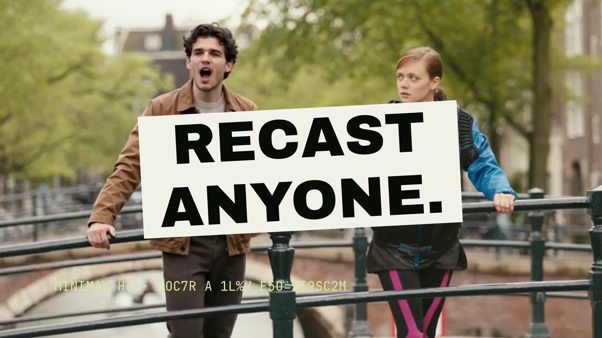

<div align="center">


<p><strong>Create footage. Change the scene. Cut the ad.</strong><br>
An open-source creative studio for short-form video, product stories and visual effects.</p>

[](LICENSE)
[](https://github.com/ItsSNOWMOBILE/aftertake/actions/workflows/ci.yml)
[](https://github.com/Comfy-Org/comfy-typescript-sdk)
[](#project-status)

**[Try the browser editor](https://aftertake-studio.right-bard-9761.chatgpt.site/studio/)** ·
**[Watch the product film](https://github.com/ItsSNOWMOBILE/aftertake/releases/tag/take-the-lead-review-2026-10-20)** ·
**[Read the studio guide](docs/studio-guide.md)**

</div>

<br>

## THEN COMES THE AFTERTAKE

[](examples/then-comes-the-aftertake/film.mp4)

**[Watch the 93-second film →](examples/then-comes-the-aftertake/film.mp4)** ·
**[Open its editable projects →](examples/then-comes-the-aftertake/README.md)**

Every shot ends. Then comes the aftertake. The film cuts through generated
portals, crystals, castles, recast characters, echoes and finishing looks, with
the real UI that made them. It runs on an original song written for it, made
with open-weight ACE-Step 1.5 on Comfy Cloud, and each section plays under its
own sung line. Its 72 shots, 84 punch titles and 26 whip, zoom, flash and glitch
transitions are native Film layers, cut to the song's beats as measured by
`aftertake_detect_beats`. It shows the real ComfyUI graph and `@comfyorg/sdk`
calls behind a take, a recorded run on an RTX 5080 with the ComfyUI console
beside it, a real agent session over MCP, and this film being cut in
Aftertake's own editor.

## TAKE THE LEAD

https://github.com/user-attachments/assets/4a8e1829-a46f-42c5-b04a-dde0e607dd7d

**[Watch the narrated 94-second film →](https://github.com/ItsSNOWMOBILE/aftertake/releases/download/take-the-lead-review-2026-10-20/aftertake-take-the-lead.mp4)** ·
**[Open the editable project and inputs →](https://github.com/ItsSNOWMOBILE/aftertake/releases/download/take-the-lead-review-2026-10-20/aftertake-take-the-lead-inputs.zip)**

One shot becomes a campaign. Bring in a character, review a real H3 replacement,
pull the tracked subject into a design, animate the headline and shape the sound.
Carry the same idea into a portrait layout, then open the film in the editor
that made it.

Made through Aftertake's native Film editor and MCP at **1080p and 24 fps**.
Designed UI animation sits alongside real recordings of the completed take,
title editing and the full project. Cards, typography, sound lanes and scene
projects stay editable. [See how the film was made →](examples/take-the-lead/README.md)

The download includes the master, scene projects, exact media, checksums and a
restore helper. Reassembling the finished inputs uses the small CPU Film runtime;
the separate character-generation recipe uses the local H3 profile. This is a
review cut, with generic Kokoro narration and a review soundtrack.

Footage: [Theo Decker / Pexels](https://www.pexels.com/video/young-man-walking-towards-camera-5321139/).
Music: [“Holy Moly” by Shane Ivers](https://www.silvermansound.com/free-music/holy-moly),
[CC BY 4.0](https://creativecommons.org/licenses/by/4.0/). UI click:
[Kenney](https://kenney.nl/assets/interface-sounds), CC0.

The [earlier 96-second campaign film and reproduction guide](examples/make-the-next-take/README.md)
and [20-second native motion study](https://github.com/ItsSNOWMOBILE/aftertake/releases/tag/native-motion-preview-2026-10-19)
remain available.

## Hotel Lobby, recast

[](examples/hotel-lobby/walkthrough.mp4)

**[Watch the 26-second generation walkthrough →](examples/hotel-lobby/walkthrough.mp4)**

A supplied portrait becomes the performer on the left. Follow the real reference,
tracked selection, H3 generation and matched before/after. A tracked-mask composite
keeps the surrounding performance, then Aftertake assembles the narration and type.
Generation waits are omitted; the UI steps are held captures from the actual run.

The [executed workflows, settings and editable film](examples/hotel-lobby/README.md)
are included. Source performance: **COLORS · Quavo & Takeoff, “HOTEL LOBBY” (2022)**;
the short demonstration is silent apart from original local narration.

**Several people, one shot.** After a take finishes, **Swap another person in
this shot** tracks the next person in that take. Each pass uses its own tracked
area; review nearby people and overlapping limbs before accepting the result.
When tracking drops the person for a moment, **Repair mask** fills gaps of up
to half a second on the CPU and shows what it added before you generate.
**Keep objects in front** puts back anything nearer the camera than the person,
like a cup or a microphone, using depth on the Neural Engine or an NPU.

## From the first prompt to the final cut

Aftertake brings generation and editing into one local workspace. Start with words,
a reference image or your own footage. Direct the shot, review the result, then
assemble it with narration and editable typography.

| Create | Direct | Finish |
| :--- | :--- | :--- |
| **Images from words** with Z-Image Turbo | **Character replacement** with SAM3 tracking, multiple reference photos and native H3 | **Portrait, square and landscape edits** in Film |
| **Video with sound** from native LTX-2.5 | **Painted, timed VFX** that composite onto the source | **Kinetic typography and motion graphics** with editable keyframes |
| **Reference-frame edits** with Qwen-Image-Edit | **Camera guidance, first/last frames and motion transfer** | **Local narration**, measured cuts and frame-based dissolves |
| **Depth-finished stills** with native DA3 Small | **Tracked subject copies** with position, scale, rotation and mask controls | **Color and texture finishing** with exact before/after frame previews |
| **Layered still compositions** from imported transparent images | **Shape and image masks**, clipping and 27 blend modes | **Selective HSL, master/RGB curves and 3D LUTs** shared with adjustment layers |

Use the visual editor or connect an agent through **45 MCP tools**. Both work with
the same local studio, persisted jobs and editable projects. Generation uses the
official Comfy SDK and open-weight model workflows; editing existing footage and
local narration can run on the CPU.

**Punch typography and transitions** add slam, word-pop, line-reveal, glitch and
scramble titles with display, condensed and mono fonts, stamp/highlight/underline
boxes and tilt, plus whip, zoom-punch, flash, glitch and push transitions between
shots. See [punch typography](docs/motion-graphics.md#punch-typography).

**Film motion graphics** adds timed shapes, image overlays and title transforms
with editable easing, independent scale axes and 720p, 1080p or 4K export canvases.
The native CPU renderer keeps these layers on the film's 24 fps clock.
See [the motion graphics guide](docs/motion-graphics.md). **Shared groups & depth**
keeps cards, images and captions attached through one editable transform, with
perspective tilt and optional shutter blur in the export.
[Author a motion scene →](docs/motion-scenes.md)

**Editable recipe starters** give you 18 places to begin. Create image has seven
product and campaign shots (studio still, lifestyle scene, hands close-up,
moodboard pin, hero banner, conceptual splash, fashion editorial). Create video
has six ad formats with matching camera looks (product showcase, TV spot,
phone-filmed UGC, unboxing, how-to and neon teaser). The frame editor has five
edits (relight, product replacement, outfit try-on, seasonal restyle and
monochrome). Load a starter, then adjust the prompt before generating; your
name, frame, source, references and seed stay as they were. Agents get the
same starters from `aftertake_generation_workspace`. These original Aftertake
prompts adapt production ideas from [Higgsfield's public skills](https://github.com/higgsfield-ai/skills/tree/f83af0bc1d937c8119099a11f8ebbf5e6fb99819)
(MIT) and [Comfy's workflow templates](https://github.com/Comfy-Org/workflow_templates/tree/86ce86e92ec77e3c3c6d4a754e69cfce37886542/templates);
they run through Aftertake's existing Z-Image, LTX-2.5 and Qwen workflows.

**Fourteen camera moves, one click.** Create video and Animate a frame open a
moves gallery where each move is a small looping diagram: push, pull, pans,
tilts, crane, truck, orbit, crash zoom, whip pan, handheld and dolly zoom.

**Sharper, smoother, scored.** **Enhance** upscales a clip ×2 with SeedVR2,
adds in-between frames with RIFE for smooth 48 fps or slow motion, and composes
songs with ACE-Step 1.5, from style tags and optional lyrics, ready for the
Film audio lanes. Inference uses native ComfyUI 0.41 nodes on your GPU;
Aftertake's media nodes load and save the video. The [RTX 5080 validation](examples/enhance/README.md)
includes all five operations, measured times, native outputs and Film handoffs.

**Know the time before you render.** Create video, Create image, the frame
editor, Render take and character replacement each show how long the job
usually takes before you start it. The estimate is the median of your earlier
runs with the same settings; until you have some, it is the time recorded on
an RTX 5080 for the shipped examples, and it says which one it is. There is no
price: every job runs on your own GPU. Agents read the same estimates from
`aftertake_generation_workspace` and `aftertake_character_workspace`, and each
generation call returns its `expected` time.

### One performance. Extra copies.

[](examples/subject-duplicates/result.mp4)

Track a person once, then position up to four extra copies without regenerating
their face or motion. Adjust scale, rotation, flip, opacity, grow and feather;
blur or darken the background through the same tracked matte. The original sound
is retained once. The **Color silhouette echoes** preset adds editable pink,
coral and orange masks behind the original performer, with individual color,
offset and opacity controls. This [reproducible example](examples/subject-duplicates/README.md)
includes the source, prepared frames, lossless mask and portable recipe, and
replays on the CPU without a running generation engine.

**Color & finish** adds five adjustable looks, white balance, exposure, contrast,
saturation, grain, sharpness and vignette. Preview the actual processed frame,
undo or redo settings, and save a new take while preserving the source clock and
audio. Selective HSL adjusts eight color ranges; master/RGB curves and an imported
display-sRGB `.cube` LUT add precise grading. Glow, warm halation and a small
prism offset provide editable optical finishes. **Hide details** blurs,
pixelates or fills boxes you draw on the frame. A box can also be a sample, and
every place those pixels appear is hidden, such as a username or key that
scrolls through a screen recording ([how it works](docs/finishing.md#hide-details)).

**Layers & masks** combines up to eight still-image and adjustment layers. Reorder,
duplicate, transform and blend images; attach rectangle, ellipse or image masks;
and limit a color grade with opacity or clipping. Preview the actual composition,
then export a PNG and a portable, hash-bound layer plan. This runs in the CPU
image runtime. See [the layer guide](docs/layer-stack.md).

**Depth & light** adds measured lens blur, haze and directional lighting
to still images, using an optional 137 MB DA3 Small model on CUDA BF16. Finish
the still, then use it as an animation reference. Video depth is not supported.

These additions were inspired by [Scumble](https://github.com/DenRakEiw/scumble).
They are independently implemented for Aftertake's video workflow;
[the feature audit and attribution](docs/scumble-inspiration.md) explain the scope.

### See it in action

| Film & short-form | Character replacement |
| :--- | :--- |
| [](https://aftertake-studio.right-bard-9761.chatgpt.site/ads/) | [](https://aftertake-studio.right-bard-9761.chatgpt.site/cast/h3.html) |
| **[Short-form ads →](https://aftertake-studio.right-bard-9761.chatgpt.site/ads/)**<br>Two narrated vertical cuts from licensed coffee footage. | **[Change the cast →](https://aftertake-studio.right-bard-9761.chatgpt.site/cast/h3.html)**<br>Tracked whole-person replacement with native H3. |

Also explore **[speech-following typography](https://aftertake-studio.right-bard-9761.chatgpt.site/type/spoken.html)**,
the **[agent editing workflow](https://aftertake-studio.right-bard-9761.chatgpt.site/agent/)**,
and the **[53-second narrated walkthrough](https://aftertake-studio.right-bard-9761.chatgpt.site/judges/)**.
The focused film was assembled in Aftertake itself; its editable
[Film project](examples/judges-film/README.md) is included.

[](https://aftertake-studio.right-bard-9761.chatgpt.site/make-it-yours/)

**[Earlier film: Make it yours · 40.5 seconds →](https://aftertake-studio.right-bard-9761.chatgpt.site/make-it-yours/)**
starts with a vertical ad, changes its hook in the actual editor, then shows
tracked copies and H3 character replacement. The closing reveal opens its own
Film timeline. [Both editable projects and the input bundle](examples/product-film/README.md)
let you reopen the main film and its coffee ad without a diffusion GPU.

## Start here

### Explore in your browser

**[Open the recorded editor →](https://aftertake-studio.right-bard-9761.chatgpt.site/studio/)**

Open the featured **H3 character replacement** or **portrait text-to-video**
cards, then explore thirteen VFX, camera and motion recipes. The character card
opens the recorded **1536 × 640** H3 take: switch between its
source, tracked selection and result, then inspect the reference photo and export
the original recipe or executed workflow. Adjust cues and compare the other
recorded takes without a GPU. Videos load as you open them. New generation,
media imports and Film export run in the local studio.

<a id="run-locally"></a>

### Run it on your computer

Works on **Windows, macOS and Linux**. You need [Node.js 22+](https://nodejs.org)
and Git. To import your own footage and export films, Aftertake also uses
Python 3.12 or newer; the launcher tells you if it is missing and how to add it.

```sh
git clone https://github.com/ItsSNOWMOBILE/aftertake.git
cd aftertake
node scripts/aftertake.mjs --examples
```

Or double-click **`start.cmd`** (Windows), **`start.command`** (macOS) or run
**`./start.sh`** (Linux) in the folder. The launcher checks your computer,
installs what is missing, starts the studio with the recorded examples and
opens it in your browser. Without `--examples` it opens your own workspace.
`node scripts/aftertake.mjs doctor` prints the checklist on its own.

No GPU or model download is needed for the examples, editing, Film, Color &
finish or agents. `node scripts/aftertake.mjs setup-npu` adds local depth for
keeping objects in front of a replaced person; it runs on the Neural Engine of
Apple silicon, the NPU of Intel Core Ultra and Snapdragon PCs, or the CPU. Optional local narration installs with
`python scripts/setup-narration.py` (Python 3.12).

### Prepare cloud rendering

Open **Render setup** to prepare a Comfy Cloud connection or a compatible managed
deployment. You can save the setup before adding an API key. Credentials stay in
the local server memory; an explicit account check never starts a generation.

**Cloud generation is not enabled yet.** Billing ownership, workflow compatibility
and remote job recovery still need verification. The recorded browser editor does
not collect keys. See the [cloud connection guide](docs/cloud-setup.md) for the
current framework and an offline character-workflow deployment inventory.

### Generate new footage

Needs **Windows or Linux** with an **NVIDIA GPU** (tested on an RTX 5080 with
16 GB) and **Python 3.12**. One command installs the engine and a model
profile; the launcher then starts the engine with the studio:

```sh
node scripts/aftertake.mjs setup-gpu --video
node scripts/aftertake.mjs
```

Choose any of `--video`, `--image`, `--frame-edit`, `--motion-transfer`,
`--camera`, `--region-edit`, `--character-swap`, `--depth`, `--upscale`,
`--interpolate` and `--song`, and add
`--models-dir=PATH` to keep models on another disk. The text-to-video profile
holds **41.67 GB** of model files. Setup and engine launch validate native CUDA
precision, kernels and memory before allocating models; see
[hardware setup and GPU selection](docs/hardware.md) for other NVIDIA devices.
Render setup in the studio shows which tools are ready.

<details>
<summary><strong>Install workflows by hand</strong></summary>

These commands add profiles to an installed runtime. Downloads verify pinned
revisions, file sizes and SHA-256 hashes. Restart the engine after installation.

| Workflow | Install | Details |
| :--- | :--- | :--- |
| Text-to-image | `python scripts/download-models.py --image-gen` | [Image creation](docs/studio-guide.md#create-image) |
| Reference-frame editing | `python scripts/download-models.py --frame-edit` | [Frame editing](docs/studio-guide.md#create-an-edited-frame) |
| Native character replacement | `python scripts/setup.py --character-swap` | [H3 setup and model terms](docs/studio-guide.md#replace-character) |
| Motion transfer | `python scripts/download-models.py --motion-transfer` | [Motion transfer](docs/studio-guide.md#transfer-motion) |
| Masked video editing | `python scripts/setup.py --inpaint` | [Adapter access and installation](docs/studio-guide.md#experimental-native-inpainting) |
| Motion-control adapter | `python scripts/download-models.py --motion` | [Camera and motion guidance](docs/studio-guide.md#animate-a-frame) |
| Upscale ×2 (SeedVR2 3B) | `python scripts/download-models.py --upscale` | [Enhance](docs/studio-guide.md#enhance-upscale-motion-and-songs) |
| Smooth and slow motion (RIFE 4.26) | `python scripts/download-models.py --interpolate` | [Enhance](docs/studio-guide.md#enhance-upscale-motion-and-songs) |
| Songs (ACE-Step 1.5) | `python scripts/download-models.py --song` | [Enhance](docs/studio-guide.md#enhance-upscale-motion-and-songs) |
| Still-image depth effects | `python scripts/setup.py --depth-effects` | [Depth, light and atmosphere](docs/depth-effects.md) |

Some profiles share model files. Sizes, dependencies and model terms are
documented in the [studio guide](docs/studio-guide.md) and pinned manifests.
Character replacement needs **FFmpeg and FFprobe during both setup and engine
launch**. Put both on PATH, or pass the same `--ffmpeg-bin /path/to/ffmpeg/bin`
to `setup.py --character-swap` and `engine.py`.

</details>

## Work with an agent

Connect an MCP client to the local studio to inspect media, create images and
video, track and replace a character, plan an edit, voice a script, and review
decoded export frames.

```sh
pnpm mcp --url http://127.0.0.1:4310 --media-root /absolute/path/to/your/footage
```

Use port `4312` if you started `pnpm demo`. The
[MCP guide](docs/mcp.md) includes a complete client configuration and tool reference.
The server exposes editing tools; your connected agent supplies the language model.

## Keep the work editable

Completed jobs retain their requests, seeds, content hashes and actual executed
graphs. Film projects retain cuts, titles, narration and timing. Export a recipe
to reuse a take, download its workflow to continue in ComfyUI, or share the
project together with its matching source media.

The [example library](examples/README.md) includes original inputs, native outputs,
recipes and attribution. [Text-to-video evidence](examples/text-video/README.md)
also includes measured engine times and decoded frame/audio checks.

| Guide | What you'll find |
| :--- | :--- |
| [Studio guide](docs/studio-guide.md) | Detailed controls, setup profiles and troubleshooting |
| [Text-to-video](docs/text-video.md) | Native video/audio sampling, formats and actual render evidence |
| [Narrated cuts](docs/narrated-cut.md) | Scripts, measured voices, captions and pacing |
| [Motion graphics](docs/motion-graphics.md) | Animated titles, shapes, image overlays and export sizes |
| [MCP reference](docs/mcp.md) | Agent setup, tools and recovery behavior |
| [Examples](examples/README.md) | Recorded projects, provenance and remixing |
| [Media attribution](docs/media-attribution.md) | Footage, fonts and generated references |

## Project status

Aftertake is an **experimental, independent project** built for the Open Source
Higgsfield challenge. It covers the workflows shown above; complete Higgsfield
feature parity is still a work in progress.

Character likeness, speaking faces, hands, occlusions and camera adherence need
visual review. A successful render or passing media check does not establish
visual quality. The browser trial reviews recorded results; fresh inference
uses your configured local engine.

## Development

```sh
pnpm build
pnpm test
```

For Python media checks, use the installed runtime:

```sh
# Windows
.runtime/venv/Scripts/python.exe -m unittest discover -s tests -p "test_*.py"

# macOS / Linux
.runtime/venv/bin/python -m unittest discover -s tests -p "test_*.py"
```

Contributions are welcome. Describe the workflow being improved and include a
small reproducible recipe or project, relevant checks, and media you have
permission to share.

## License and acknowledgments

Aftertake's application code and custom nodes are **[MIT licensed](LICENSE)**.
Model weights, third-party runtimes, fonts and footage retain their own terms.

Built with [ComfyUI](https://github.com/Comfy-Org/ComfyUI),
the [Comfy SDK](https://github.com/Comfy-Org/comfy-typescript-sdk),
[H3 Relay](https://github.com/akatz-ai/h3-relay),
LTX, MiniMax H3, SAM3, Wan Animate, Qwen, Z-Image and Kokoro.
See the [full credits and model licenses](docs/studio-guide.md#credits-and-licenses)
and [media attribution](docs/media-attribution.md) for sources and notices.
