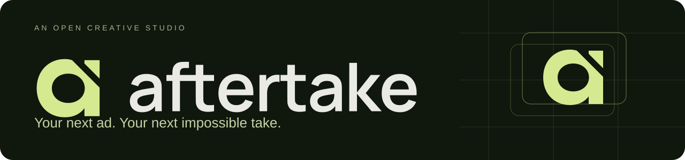
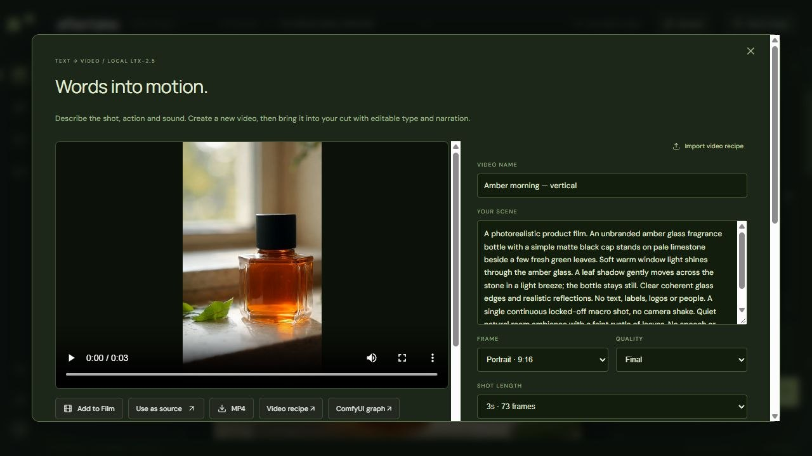
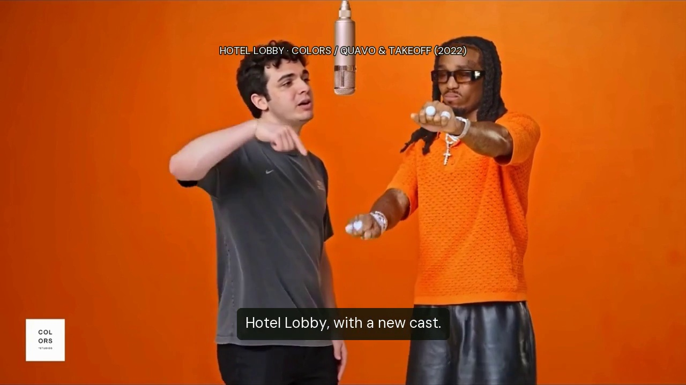
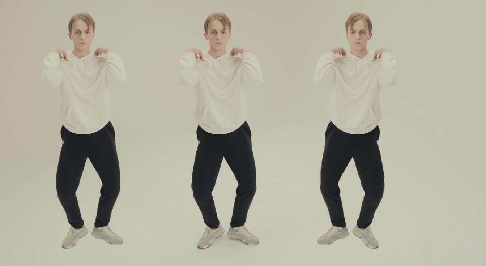
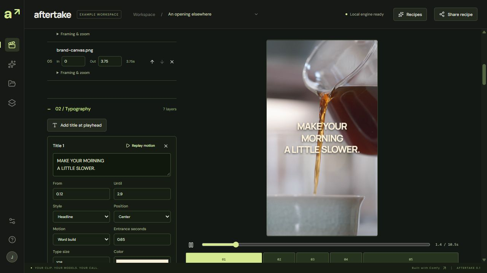
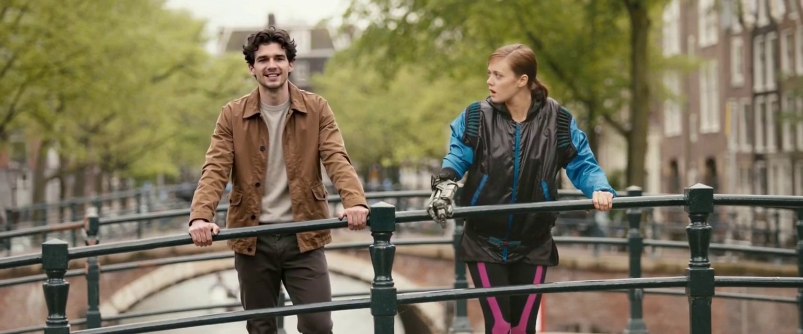
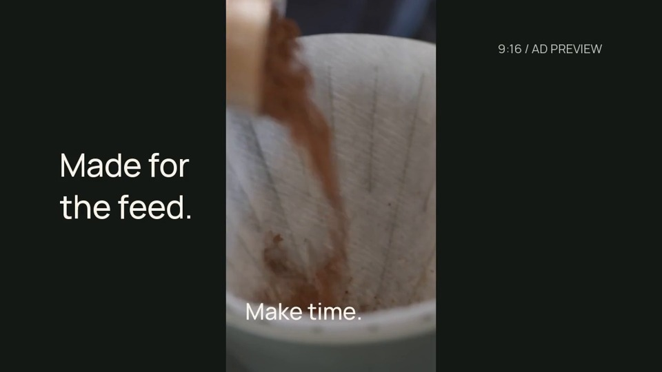

<div align="center">



<p><strong>Create footage. Change the scene. Cut the ad.</strong><br>
An open-source creative studio for short-form video, product stories and visual effects.</p>

[](LICENSE)
[](https://github.com/ItsSNOWMOBILE/aftertake/actions/workflows/ci.yml)
[](https://github.com/Comfy-Org/comfy-typescript-sdk)
[](#project-status)

**[Try the browser editor](https://aftertake-studio.right-bard-9761.chatgpt.site/studio/)** ·
**[Watch the demo](https://aftertake-studio.right-bard-9761.chatgpt.site/)** ·
**[Read the studio guide](docs/studio-guide.md)**

</div>

<br>

[](https://aftertake-studio.right-bard-9761.chatgpt.site/create/)

<p align="center"><sub>A real local LTX-2.5 render, with generated ambience. <a href="https://aftertake-studio.right-bard-9761.chatgpt.site/create/">Watch the shot and inspect its workflow →</a></sub></p>

## Hotel Lobby, recast

[](examples/hotel-lobby/walkthrough.mp4)

**[Watch the 26-second generation walkthrough →](examples/hotel-lobby/walkthrough.mp4)**

A supplied portrait becomes the performer on the left. Follow the real reference,
tracked selection, H3 generation and matched before/after. A tracked-mask composite
keeps the surrounding performance, then Aftertake assembles the narration and type.
Generation waits are omitted; the UI steps are held captures from the actual run.

The [executed workflows, settings and editable film](examples/hotel-lobby/README.md)
are included. Source performance: **COLORS · Quavo & Takeoff, “HOTEL LOBBY” (2022)**;
the short demonstration is silent apart from original local narration.

## From the first prompt to the final cut

Aftertake brings generation and editing into one local workspace. Start with words,
a reference image or your own footage. Direct the shot, review the result, then
assemble it with narration and editable typography.

| Create | Direct | Finish |
| :--- | :--- | :--- |
| **Images from words** with Z-Image Turbo | **Character replacement** with SAM3 tracking, multiple reference photos and native H3 | **Portrait, square and landscape edits** in Film |
| **Video with sound** from native LTX-2.5 | **Painted, timed VFX** that composite onto the source | **Kinetic typography and motion graphics** with editable keyframes |
| **Reference-frame edits** with Qwen-Image-Edit | **Camera guidance, first/last frames and motion transfer** | **Local narration**, measured cuts and frame-based dissolves |
| **Depth-finished stills** with native DA3 Small | **Tracked subject copies** with position, scale, rotation and mask controls | **Color and texture finishing** with exact before/after frame previews |
| **Layered still compositions** from imported transparent images | **Shape and image masks**, clipping and 27 blend modes | **Selective HSL, master/RGB curves and 3D LUTs** shared with adjustment layers |

Use the visual editor or connect an agent through **40 MCP tools**. Both work with
the same local studio, persisted jobs and editable projects. Generation uses the
official Comfy SDK and open-weight model workflows; editing existing footage and
local narration can run on the CPU.

**Film motion graphics** adds timed shapes, image overlays and title transforms
with editable easing, independent scale axes and 720p, 1080p or 4K export canvases.
The native CPU renderer keeps these layers on the film's 24 fps clock.
See [the motion graphics guide](docs/motion-graphics.md).

### One performance. Extra copies.

[](examples/subject-duplicates/result.mp4)

Track a person once, then position up to four extra copies without regenerating
their face or motion. Adjust scale, rotation, flip, opacity, grow and feather;
blur or darken the background through the same tracked matte. The original sound
is retained once. This [reproducible example](examples/subject-duplicates/README.md)
includes the source, prepared frames, lossless mask and portable recipe, and
replays on the CPU without a running generation engine.

**Color & finish** adds five adjustable looks, white balance, exposure, contrast,
saturation, grain, sharpness and vignette. Preview the actual processed frame,
undo or redo settings, and save a new take while preserving the source clock and
audio. Selective HSL adjusts eight color ranges; master/RGB curves and an imported
display-sRGB `.cube` LUT add precise grading. Glow, warm halation and a small
prism offset provide editable optical finishes.

**Layers & masks** combines up to eight still-image and adjustment layers. Reorder,
duplicate, transform and blend images; attach rectangle, ellipse or image masks;
and limit a color grade with opacity or clipping. Preview the actual composition,
then export a PNG and a portable, hash-bound layer plan. This runs in the CPU
image runtime. See [the layer guide](docs/layer-stack.md).

**Depth & light** adds measured lens blur, haze and directional lighting
to still images, using an optional 137 MB DA3 Small model on CUDA BF16. Finish
the still, then use it as an animation reference. Video depth is not supported.

These additions were inspired by [Scumble](https://github.com/DenRakEiw/scumble).
They are independently implemented for Aftertake's video workflow;
[the feature audit and attribution](docs/scumble-inspiration.md) explain the scope.

### See it in action

| Film & short-form | Character replacement |
| :--- | :--- |
| [](https://aftertake-studio.right-bard-9761.chatgpt.site/ads/) | [](https://aftertake-studio.right-bard-9761.chatgpt.site/cast/h3.html) |
| **[Short-form ads →](https://aftertake-studio.right-bard-9761.chatgpt.site/ads/)**<br>Two narrated vertical cuts from licensed coffee footage. | **[Change the cast →](https://aftertake-studio.right-bard-9761.chatgpt.site/cast/h3.html)**<br>Tracked whole-person replacement with native H3. |

Also explore **[speech-following typography](https://aftertake-studio.right-bard-9761.chatgpt.site/type/spoken.html)**,
the **[agent editing workflow](https://aftertake-studio.right-bard-9761.chatgpt.site/agent/)**,
and the **[53-second narrated walkthrough](https://aftertake-studio.right-bard-9761.chatgpt.site/judges/)**.
The focused film was assembled in Aftertake itself; its editable
[Film project](examples/judges-film/README.md) is included.

[](https://aftertake-studio.right-bard-9761.chatgpt.site/make-it-yours/)

**[Make it yours · 40.5 seconds →](https://aftertake-studio.right-bard-9761.chatgpt.site/make-it-yours/)**
starts with a vertical ad, changes its hook in the actual editor, then shows
tracked copies and H3 character replacement. The closing reveal opens its own
Film timeline. [Both editable projects and the input bundle](examples/product-film/README.md)
let you reopen the main film and its coffee ad without a diffusion GPU.

## Start here

### Explore in your browser

**[Open the recorded editor →](https://aftertake-studio.right-bard-9761.chatgpt.site/studio/)**

Open the featured **H3 character replacement** or **portrait text-to-video**
cards, then explore thirteen VFX, camera and motion recipes. The character card
opens the recorded **1536 × 640** H3 take: switch between its
source, tracked selection and result, then inspect the reference photo and export
the original recipe or executed workflow. Adjust cues and compare the other
recorded takes without a GPU. Videos load as you open them. New generation,
media imports and Film export run in the local studio.

<a id="run-locally"></a>

### Run the examples locally

Requires **Node.js 22.12+**, **pnpm** and **Git**. No Python, GPU or model download
is needed to explore the recorded examples.

```sh
git clone https://github.com/ItsSNOWMOBILE/aftertake.git
cd aftertake
pnpm install --frozen-lockfile
pnpm demo
```

Open **http://127.0.0.1:4312**. Examples run in a separate workspace.

To import your own footage and export films, install the small CPU runtime:

```sh
python scripts/setup-film.py
```

The studio prefers a healthy Film runtime for media processing, independently of
the generation engine. To choose another installation, set `AFTERTAKE_PYTHON`
in `.env` to its Python executable (`bin/python` on Linux or `Scripts/python.exe`
on Windows). An explicit selection is never replaced by another runtime.

Optional local narration is installed separately with
`python scripts/setup-narration.py`. These Python setup paths use **Python 3.12**.

### Prepare cloud rendering

Open **Render setup** to prepare a Comfy Cloud connection or a compatible managed
deployment. You can save the setup before adding an API key. Credentials stay in
the local server memory; an explicit account check never starts a generation.

**Cloud generation is not enabled yet.** Billing ownership, workflow compatibility
and remote job recovery still need verification. The recorded browser editor does
not collect keys. See the [cloud connection guide](docs/cloud-setup.md) for the
current framework and an offline character-workflow deployment inventory.

### Generate new footage

Requires **Python 3.12**, an **NVIDIA CUDA GPU**, and space for the selected
model profile. The tested development host is Windows with an RTX 5080
(16 GB VRAM) and 32 GB RAM; minimum supported hardware is not yet established.
Setup and engine launch now validate native CUDA precision, kernels and available
memory before model allocation. See [hardware setup and GPU selection](docs/hardware.md)
for other NVIDIA devices, sequential offloading and explicit preflight checks.

For native text-to-video with optional generated sound:

```sh
python scripts/setup.py --skip-models
python scripts/download-models.py --text-video
python scripts/engine.py --safe-weight-copies --no-node-cache
```

In another terminal, start the studio:

```sh
pnpm dev
```

Open **http://127.0.0.1:4310** and choose **Create video**. This pinned profile
contains **41.67 GB** of model files; allow additional space for the runtime
and caches. Add `--models-dir /path/to/models` to the download command to use
another disk.

<details>
<summary><strong>Add other generation workflows</strong></summary>

These commands add profiles to an installed runtime. Downloads verify pinned
revisions, file sizes and SHA-256 hashes. Restart the engine after installation.

| Workflow | Install | Details |
| :--- | :--- | :--- |
| Text-to-image | `python scripts/download-models.py --image-gen` | [Image creation](docs/studio-guide.md#create-image) |
| Reference-frame editing | `python scripts/download-models.py --frame-edit` | [Frame editing](docs/studio-guide.md#create-an-edited-frame) |
| Native character replacement | `python scripts/setup.py --character-swap` | [H3 setup and model terms](docs/studio-guide.md#replace-character) |
| Motion transfer | `python scripts/download-models.py --motion-transfer` | [Motion transfer](docs/studio-guide.md#transfer-motion) |
| Masked video editing | `python scripts/setup.py --inpaint` | [Adapter access and installation](docs/studio-guide.md#experimental-native-inpainting) |
| Motion-control adapter | `python scripts/download-models.py --motion` | [Camera and motion guidance](docs/studio-guide.md#animate-a-frame) |
| Still-image depth effects | `python scripts/setup.py --depth-effects` | [Depth, light and atmosphere](docs/depth-effects.md) |

Some profiles share model files. Sizes, dependencies and model terms are
documented in the [studio guide](docs/studio-guide.md) and pinned manifests.
Character replacement needs **FFmpeg and FFprobe during both setup and engine
launch**. Put both on PATH, or pass the same `--ffmpeg-bin /path/to/ffmpeg/bin`
to `setup.py --character-swap` and `engine.py`.

</details>

## Work with an agent

Connect an MCP client to the local studio to inspect media, create images and
video, track and replace a character, plan an edit, voice a script, and review
decoded export frames.

```sh
pnpm mcp --url http://127.0.0.1:4310 --media-root /absolute/path/to/your/footage
```

Use port `4312` if you started `pnpm demo`. The
[MCP guide](docs/mcp.md) includes a complete client configuration and tool reference.
The server exposes editing tools; your connected agent supplies the language model.

## Keep the work editable

Completed jobs retain their requests, seeds, content hashes and actual executed
graphs. Film projects retain cuts, titles, narration and timing. Export a recipe
to reuse a take, download its workflow to continue in ComfyUI, or share the
project together with its matching source media.

The [example library](examples/README.md) includes original inputs, native outputs,
recipes and attribution. [Text-to-video evidence](examples/text-video/README.md)
also includes measured engine times and decoded frame/audio checks.

| Guide | What you'll find |
| :--- | :--- |
| [Studio guide](docs/studio-guide.md) | Detailed controls, setup profiles and troubleshooting |
| [Text-to-video](docs/text-video.md) | Native video/audio sampling, formats and actual render evidence |
| [Narrated cuts](docs/narrated-cut.md) | Scripts, measured voices, captions and pacing |
| [Motion graphics](docs/motion-graphics.md) | Animated titles, shapes, image overlays and export sizes |
| [MCP reference](docs/mcp.md) | Agent setup, tools and recovery behavior |
| [Examples](examples/README.md) | Recorded projects, provenance and remixing |
| [Media attribution](docs/media-attribution.md) | Footage, fonts and generated references |

## Project status

Aftertake is an **experimental, independent project** built for the Open Source
Higgsfield challenge. It covers the workflows shown above; complete Higgsfield
feature parity is still a work in progress.

Character likeness, speaking faces, hands, occlusions and camera adherence need
visual review. A successful render or passing media check does not establish
visual quality. The browser trial reviews recorded results; fresh inference
uses your configured local engine.

## Development

```sh
pnpm build
pnpm test
```

For Python media checks, use the installed runtime:

```sh
# Windows
.runtime/venv/Scripts/python.exe -m unittest discover -s tests -p "test_*.py"

# macOS / Linux
.runtime/venv/bin/python -m unittest discover -s tests -p "test_*.py"
```

Contributions are welcome. Describe the workflow being improved and include a
small reproducible recipe or project, relevant checks, and media you have
permission to share.

## License and acknowledgments

Aftertake's application code and custom nodes are **[MIT licensed](LICENSE)**.
Model weights, third-party runtimes, fonts and footage retain their own terms.

Built with [ComfyUI](https://github.com/Comfy-Org/ComfyUI),
the [Comfy SDK](https://github.com/Comfy-Org/comfy-typescript-sdk),
[H3 Relay](https://github.com/akatz-ai/h3-relay),
LTX, MiniMax H3, SAM3, Wan Animate, Qwen, Z-Image and Kokoro.
See the [full credits and model licenses](docs/studio-guide.md#credits-and-licenses)
and [media attribution](docs/media-attribution.md) for sources and notices.
