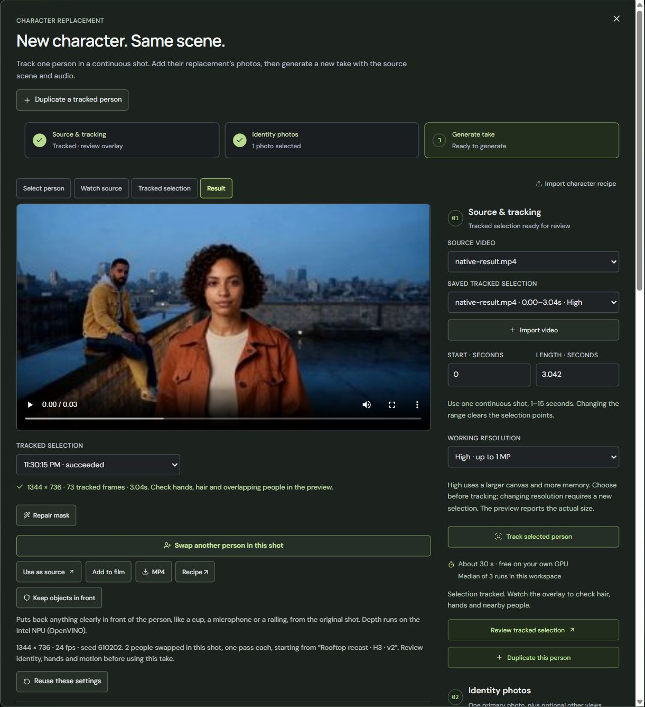

# Two-person character prompt retry

The controlled retry visibly replaces the seated man on the far left while preserving the woman from the original H3 pass. Only the additional prompt changed; reference, head crop, tracked mask, seed 610202, High 768 and wardrobe settings match the failed baseline. The original failed records and media remain intact in the parent folder.

The new prompt explicitly describes the seated man, his short hair and beard, the mustard corduroy jacket and grey hoodie, and the foreground woman whose face and rust jacket must remain. controlled-delta.json contains the exact one-field comparison.

## Actual run and delivery

The retry used 374.042 native engine seconds and 375.915 app wall seconds. take.mp4 is the actual 1344 x 736 H3 output, with 73 frames at 24 fps and a duration of 3.041667 s. Its bytes match the durable native record.

After the root operator used the actual UI Add to film action, the normal Film API exported result.mp4 at 1280 x 720. The Film asset was matched to the native take by both SHA and fetched media bytes. Source volume is 1, audio normalization is false, and the cover transform matches the existing ../before-720p.mp4. The original comparison source was referenced rather than duplicated or re-exported.

film-request.json records the export request; film-render.json is the exact durable Film receipt; film-manifest.json is the portable project for replay. delivery-binding.json records media hashes and the shared comparison source. No external hand encoding or synthetic composite was used for delivery.

Native audio correlations against the original source are 0.99990 and 0.99990. The 720p delivery correlations are 0.99965 and 0.99973, with gains 0.99954 and 0.99953. Both outputs pass continuous 24 fps timestamps, duration, dimensions and aligned source-audio coverage checks.

## Visual review and UI proof

Actual native frames 0, 24, 48 and 72, a full 73-frame contact, and detailed head/shoulder comparisons were reviewed. The intended seated man is consistently replaced, the foreground woman's face/curls/outfit remain coherent, and the old late-frame yellow shoulder patch is absent in the reviewed retry samples. The target face is small; this review does not establish pixel-perfect likeness or biometric identity. Contact sheets also cannot rule out every subpixel seam or brief motion artifact.

The real application ancestry counts two replacement passes, and the root UI operator directly observed that count and the completed Film handoff. chain-evidence.json records the actual chain computed by the app function; ui-observation.json explicitly identifies the direct UI observations as text evidence.

The actual app screenshot now shows this successful retry and the two-person count. [Capture provenance](../screenshot-capture.json) records the displayed take, original viewport hash and crop. Earlier capture failures remain historical notes in ui-observation.json.

## Shared assets and replay

The original source, prepared source, reference image and its generation record, person mask, tracked selection and model pins remain in the parent folder without duplication. shared-baseline-bindings.json gives relative paths and SHAs. The earlier woman's pass remains linked through that baseline's original ancestry records.

Reimport the shared media, restore/rebind the selection and source IDs, then use request.json with seed 610202 and the exact explicit prompt. The new H3 and Film native records remain byte-identical to their durable application records. Use the normal Film manifest to reproduce the 720p delivery after rebinding its imported asset. Models retain their own pinned publisher terms.
