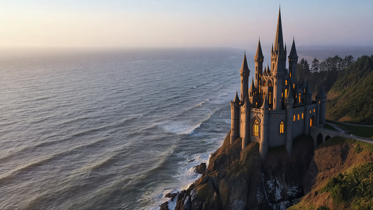
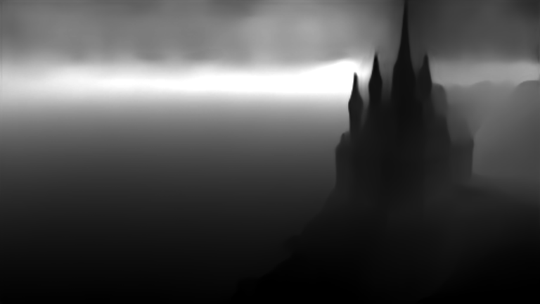
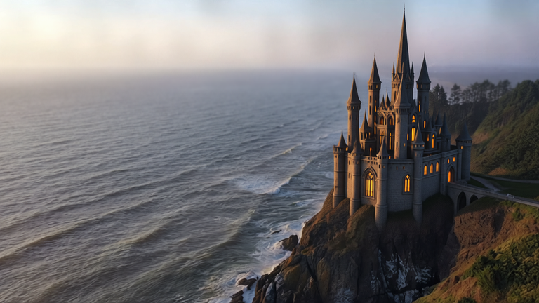

# Native depth: castle atmosphere

A real still-image DA3 Small estimate drives a gentle depth-of-field, haze and soft-light finish. The original source, processed output, numerical depth and executed native workflow are included.

| Source | Actual model depth | Finished image |
| --- | --- | --- |
|  |  |  |

- [Recipe](recipe.json): import it after importing the matching `source.png`; importing settings does not render.
- [Executed ComfyUI workflow](workflow-api.json): load the source in the first node, then queue with the optional depth profile installed.
- [Lossless depth array](raw-depth.npz): NumPy archive with a `depth` float array, shape `432 × 768`. Load with `allow_pickle=False`.
- [Provenance and hashes](provenance.json): app/native job identities, source/model/raw-depth/output hashes and effect settings.

The source is the Qwen-edited frame from the existing [castle camera example](../castle-pullback/), normalized by Aftertake's standard image import. The underlying coastal footage is [Dean Diemert’s lighthouse video](https://www.pexels.com/video/a-lighthouse-is-seen-from-above-on-the-coast-20730898/), under the [Pexels License](https://www.pexels.com/license/). Full source attribution remains in [media attribution](../../docs/media-attribution.md). No creator endorsement is implied; model terms apply separately to generated derivatives. This adds no new footage or personal reference photos.

Inference uses [Comfy Org's DA3 Small checkpoint](https://huggingface.co/Comfy-Org/Depth-Anything-3), under Apache-2.0, at explicit native CUDA **BF16** precision. The model revision and SHA-256 are recorded in the recipe. The native loader, inference and attention are unchanged. Blur, haze and soft shading are CPU image effects based on the resulting depth.

`depth.png` is a display-only visualization extracted from the actual native artifact. The native PNG's embedded raw array is omitted here to avoid storing it twice; `raw-depth.npz` retains that exact numerical depth, and provenance records the native-artifact and raw-array hashes separately.

This is a **still-image feature**. Lighting approximates surface normals and camera intrinsics from monocular depth; it does not produce measured lights or physical shadows. No temporal stability or video-depth feature is claimed. See [Depth and atmosphere](../../docs/depth-effects.md) for setup and controls.
