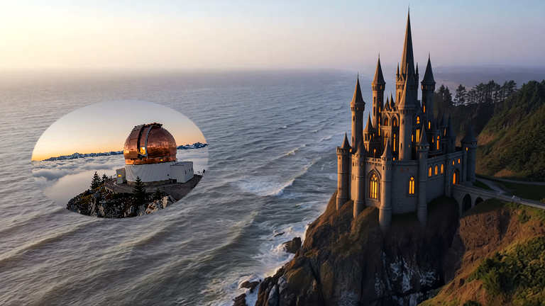

# Editable layered still

This is a CPU composition of existing Aftertake images, with an oval
picture-in-picture inset, a masked soft-light contrast layer and a finishing
adjustment. It demonstrates editable layers and masks; no new diffusion pass
was used to make the composite.

1. Open **Layers & masks** in the local studio.
2. Import `examples/coastal-kingdom/edited-first-frame.png` and
   `examples/observatory/source.png` using **Import image**.
3. Choose **Import plan** and select this folder's `recipe.json`.
4. Render a preview, adjust the stack, or save the PNG.

The plan resolves imported images by SHA-256, so local asset IDs may differ.
No new composition starts merely by importing the plan. Original sources remain
editable, and layer order is shown top first in the UI, bottom first in the file.

The real preview, saved output and fresh-workspace replay produced identical PNG
hashes in the tested CPU runtime. `provenance.json` records the result, source
hashes and the scope of that check. This is a still-image feature.

The coastal image is a Qwen edit of Dean Diemert's licensed Pexels source, with
its original attribution in the coastal-kingdom example. The observatory is an
existing local Z-Image generation with its saved recipe. No Scumble images or
source code are included.
