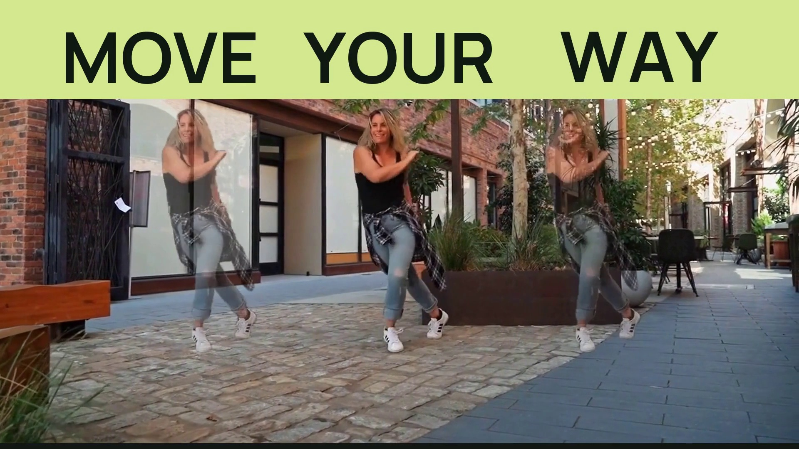

# Make the next take.

**[Watch the narrated 96-second film](https://github.com/ItsSNOWMOBILE/aftertake/releases/download/product-film-preview-2026-10-19/aftertake-make-the-next-take.mp4)** ·
**[Download the editable media package](https://github.com/ItsSNOWMOBILE/aftertake/releases/download/product-film-preview-2026-10-19/aftertake-product-film-inputs.zip)**

Three related dance takes become **MOVE YOUR WAY**, a fictional street-dance
campaign. The film opens with the finished campaign, follows the creative
decisions in the app, and closes on the actual Aftertake project behind the film
itself.



## An edit you can reopen

The main project is a native **1080p, 24 fps, 96-second Film** with 47 cuts,
39 titles, 20 graphics and 23 sound clips. It was authored through Aftertake's
MCP and exported by its normal Film renderer. Typography, transforms, easing,
source trims, complete narration clips and music levels remain editable.

The package also contains the original eight-second landscape, portrait and
square campaign projects. They preserve their own shots and layers. The portrait
composition uses actual portrait footage; the format comparison uses stills from
the three real exports.

The dancer echoes copy tracked source pixels. They do not generate new faces or
performances. Local SAM3 tracking runs through Comfy SDK; color, compositing,
graphics and Film assembly use native Aftertake operations. The generic Kokoro
`af_sarah` narration was generated locally, with its actual scripts and receipts.
Music levels and fades are authored in Film.

UI passages are edited sequences of genuine app captures with fixed framing and
native focus graphics. Processing waits are omitted. They are not a continuous
recording of one editing session or a generation-speed benchmark. The closing
reveal was captured from this product-film project before its own capture was
imported into the edit.

## Reproduce the film

Use the application revision recorded in the accompanying package. Install the
JavaScript dependencies and CPU Film runtime, then start the demo workspace:

```sh
pnpm install --frozen-lockfile
python scripts/setup-film.py
pnpm demo
```

Download the companion ZIP above, then run the checked unpacker from the
repository root:

```sh
python examples/make-the-next-take/unpack.py aftertake-product-film-inputs.zip --root .
```

It verifies the package's paths and SHA-256 bindings before writing, and refuses
to overwrite a differing existing file. The package retains its
`examples/make-the-next-take/` layout.

Import the media with the repository's normal helper:

```sh
python scripts/import-film-project.py examples/make-the-next-take/project.json --url http://127.0.0.1:4312
```

Open **Film → Import film project**, select `project.json`, inspect the edit and
choose **Export film**. Repeat with `campaign-landscape.json`,
`campaign-portrait.json` or `campaign-square.json` to edit a campaign version.
The standalone campaign projects are the silent visual passes; the narrated
product film carries the licensed music mix.

For agent editing, import the companions, pass the parsed project to
`aftertake_save_film_edit`, and export the returned plan with
`aftertake_export_plan`. Use `aftertake_plan_status` to rejoin an existing
attempt. Create a plan in the destination workspace rather than reusing a plan
ID from the original machine.

Reassembling these completed media assets needs no diffusion GPU, model download,
API key or generation credit. Fresh tracking or generation has separate model
and hardware requirements. A 1080p export canvas does not imply that every
source was captured or generated at that resolution.

## Credits

Dance footage by **RDNE Stock project / Pexels**, under the
[Pexels License](https://www.pexels.com/license/):

- [Energetic Woman Dancing](https://www.pexels.com/video/energetic-woman-dancing-8928240/)
- [Woman Dancing on the Street](https://www.pexels.com/video/woman-dancing-on-the-street-8928299/)
- [Man and Woman Dancing Together Outdoors](https://www.pexels.com/video/man-and-woman-dancing-together-outdoors-8928246/)

Selected excerpts were tracked, duplicated, graded, placed and edited with
original typography. MOVE YOUR WAY is a fictional concept campaign; no performer
or source-creator endorsement is implied.

**[“Galactic Rap” — Kevin MacLeod](https://incompetech.com/music/royalty-free/index.html?isrc=USUAN2300009)**
(incompetech.com), licensed under
[Creative Commons Attribution 4.0](https://creativecommons.org/licenses/by/4.0/).
The source is excerpted from 0:00 to 1:36, faded and mixed beneath narration.
Phase-aligned native gain layers adjust its level; it is not looped or stretched.

Models retain their publisher terms:
[SAM3.1](https://huggingface.co/Comfy-Org/sam3.1),
[Kokoro-82M](https://huggingface.co/hexgrad/Kokoro-82M) and
[kokoro-onnx](https://github.com/thewh1teagle/kokoro-onnx).
Manrope and DM Sans retain their SIL Open Font License notices in the app.
Aftertake's MIT code license does not replace media, font or model terms.

This is a review preview. It has not been submitted to the competition.
